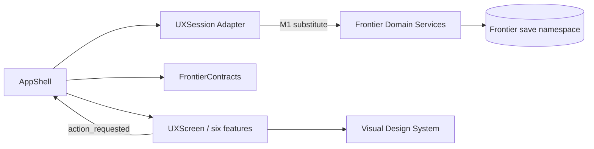

# Rocket Prospectors — 多 AI 协作工程架构 V1.0

**适用范围**：新的独立 Frontier Godot 工程，仅覆盖当前 GDD V1.0 的六屏 UX 和将来短局经营所需的架构。旧 V4 的代码、架构归档及过时交接文件已剔除，不作为当前需求依赖。

## 1. 总体原则

1. **GDD 定义规则、UX 定义交互、程序实现状态变化**；任一层不得越权静默修改上一层。
2. **一个状态修改入口**：页面只发 `action_requested(action_id, payload)`，应用层转发到 `UXSession.apply()`。M1 时将 `UXSession` 换成真正的 `FrontierCommandService`；不要求每个界面逐一重写按钮。
3. **资金/矿石/火箭库存唯一所有权**：正式数据由相应领域服务操作；交易跨所有权必须原子化、可追踪、幂等。
4. **视觉必须是纯表现**：动画、Shader、音效可以失败或跳过，但不能导致经济命令重放。
5. **单一 Shell**：只有集成 AI 修改导航/跨界面依赖；各功能 AI 在各自目录中独立开发。
6. **项目与存档独立**：当前工程不依赖外部旧项目；M1 需要引入自己的 `save_schema_version` 和 `user://frontier/` 持久化数据。

## 2. 已创建的文件结构

```text
Rocket_Prospectors_UX_V1_Project/
├── project.godot                  # 独立 Godot 4 项目
├── scenes/
│   ├── main.tscn                 # 六屏完整 UX 容器
│   ├── screens/                  # 六个可编辑页面场景
│   └── demos/                    # 六个独立 F6 启动的场景
├── scripts/
│   ├── app/
│   │   ├── app_shell.gd          # 只管导航、反馈、页面组装
│   │   └── screen_demo_runner.gd # 独立开发样例状态
│   ├── contracts/
│   │   └── frontier_contracts.gd # 稳定命令 ID / 模块归属
│   ├── core/
│   │   └── ux_session.gd         # 演示命令适配器（非真实经营引擎）
│   ├── features/
│   │   ├── hq/presentation/
│   │   ├── auction/presentation/
│   │   ├── expedition/presentation/
│   │   ├── assembly/presentation/
│   │   ├── market/presentation/
│   │   └── settlement/presentation/
│   ├── ui/
│   │   ├── design_system.gd      # 颜色/通用控件/样式
│   │   └── ux_screen.gd          # 页面协议 / 事件基类
│   └── tests/test_ux_flow.gd     # 演示状态保护用例
├── assets/ux/wireframes/        # 六张可编辑的 1440×900 SVG
├── assets/ux/previews/          # 六张 PNG 预览
├── docs/
│   ├── gdd/                     # GDD V1.0 + 未决策台账
│   ├── ux/                      # UX V1.0 与交互验收
│   ├── architecture/            # 当前架构 / 接口契约
│   └── production/              # 任务板与用户测试
├── tools/
│   ├── generate_wireframes.py # 重生成可编辑 UX 图
│   └── check_project.py       # 静态资源和架构检查
├── AGENTS.md                     # 多 AI 文件所有权纪律
└── .github/PULL_REQUEST_TEMPLATE.md
```

## 3. 运行时依赖（单向）



**UX 阶段：** `AppShell → UXSession.apply()`；这只是供 UX 点击演示用的轻量 mock。`frontier_contracts.gd` 提供稳定 command IDs。  
**M1 阶段：** `AppShell → FrontierCommandService.execute(command) → 授权领域服务 → DomainEvent → 视觉层响应`。保持 `action_id` 与 `payload` 的最小外部协议，必要的 schema 变更须由 Integration AI 先批准。

## 4. 核心协议

### 页面交互协议
- `UXScreen.mount(session: UXSession)`：注入只读展示所需的会话数据（UX 阶段为 mock；M1 改为不可变 snapshot）。
- `UXScreen.action_requested(action_id: String, payload: Dictionary)`：界面发起命令意图，不直接改 `session.cash` / `session.mined_t`。
- `UXScreen.route_requested(route_id: String)`：界面请求导航，由 Shell 统一执行。
- `UXScreen.render()`：根据当前 snapshot 重建页面；正式版本应迁至局部刷新，避免频繁重建拖拽组件。

### 领域结果（目标接口，未完全落地）
```gdscript
{
  "ok": true,
  "command_id": "dispatch",
  "request_id": "unique-id",
  "message": "完成一趟运输",
  "state_revision": 12,
  "events": [{"type": "cargo_delivered", "payload": {"tons": 80}}],
  "snapshot": {"cash": 27100, "inventory": {"port": 80}}
}
```
真实服务必须明确 `request_id` 幂等、状态快照版本、原子库存转移、失败无副作用。`UXSession.apply()` 当前只实现基本拒绝重复操作，不满足完整事务保证。

### 命令与负责模块

| 命令 ID | 归属 AI/功能 | 现阶段 |
|---|---|---|
| `win_lot` | Auction | Mock 成交，无 AI 实时竞价 |
| `scan` | Expedition | Mock 扣费并标记扫描 |
| `deploy` | Expedition | Mock 扣费与 80t 示范产出 |
| `dispatch` | Aerospace/Fleet | Mock 一次性港口交付 |
| `change_craft` | Assembly | Mock 选择预设火箭 |
| `mount_part` | Assembly | Mock 安装部件，仅校验插槽类型 |
| `sell` | Market/Economy | Mock 固定单价与库存消耗 |
| `reset_round` | Progression | Mock 新轮重置，保留现金 |

## 5. 多 AI 代码所有权

- **Integration AI**：`scripts/app/**`, `scripts/contracts/**`, `scripts/core/**`, `scenes/main.tscn`, 文档版本决策和合并 PR。
- **UX / Visual AI**：`scripts/ui/**`, `assets/ux/**`, `docs/ux/**`；其他 AI 不擅自改全局 UI Token。
- **HQ / Auction AI**：`scripts/features/hq/**`, `scripts/features/auction/**`, 对应 `scenes/screens/*`。
- **Mining / Galaxy AI**：`scripts/features/expedition/**` 与对应场景；不得修改库存或勘探收费。
- **Rocket AI**：`scripts/features/assembly/**`，后续新增 `scripts/features/fleet/**`；不得私自改飞船真实运价公式。
- **Market / Settlement AI**：`scripts/features/market/**`, `scripts/features/settlement/**`；不得改结算服务或现金账本。
- **QA AI**：`scripts/tests/**`, `docs/production/UX_TEST_SCRIPT.md`；规则冲突报告给 Integration AI。

所有 AI 可以在独立工作树（git worktree）中基于相同 `main` 新建功能分支。一个 PR 最好只覆盖一个页面/一个可测试交互；合并前执行 Godot headless + 本地任务脚本，记录实际结果。

## 6. 下一阶段要建立的真实领域目录（尚未实现）

```text
scripts/domain/
  auction/        AuctionService, LicenseState, RivalBids
  exploration/    PlanetGenerator, SurveyService, Discovery
  mining/         MiningService, MiningFacility, MineralReserve
  fleet/          RocketBlueprint, FlightPlan, DispatchService, Recovery
  warehouse/      InventoryLedger, LoadingPolicy
  market/         BuyerQuotes, MarketService, PriceEvolution
  economy/        CashLedger, LoanService, FinancialReport
  research/       UpgradeService, UnlockTree
  progression/    CampaignState, Settlement, Victory
  rivals/         RivalPlanning, FairBidAI
```

这些是建议目标模块，不是已完成源码。仍由 4–6 个 AI 按明确职责阶段开发，而不是 10 个 AI 各自更改同一套游戏状态。

## 7. 当前项目后续实施路线（无旧版代码依赖）

1. 保留 `project.godot` 与 `scenes/main.tscn` 为新游戏的唯一入口；六屏由 AppShell 协调。
2. 先完成 Godot 引擎导入、六屏人工验证与 1280×720/1920×1080 测试，确保 UX 原型稳定。
3. M1 由 Integration AI 新建 `scripts/domain/`、`scripts/core/frontier_command_service.gd` 与 `user://frontier/` 存档模型。
4. `UXSession` **只作为 Mock 适配器**。替换时保持 `action_requested` 契约，新增真实状态查询和原子命令服务。
5. 如需复用历史算法，按新 GDD 筛选、移植、单独测试。禁止把旧 30–50 小时长线玩法的场景布局或结算模型整体搬进来。

## 8. 本阶段技术债与注意事项

- `UXSession` 仅模拟一回合：没有存档、真实生产、市场演化、竞拍 AI、股份与自动时间推进。
- 六屏动态重建控件只适合 UX 原型；正式引擎应采用局部刷新与稳定节点引用。
- SVG 原型与 Godot 页面不是逐像素绑定；运行端必须进行分辨率验收。
- 当前交付未执行 Godot Parser 与 GUI 测试，因此架构“已搭建”不代表运行时已验收。
- 本项目只保留当前 GDD、UX、架构、开发与测试所需文档，不再维护旧长线架构文档。
