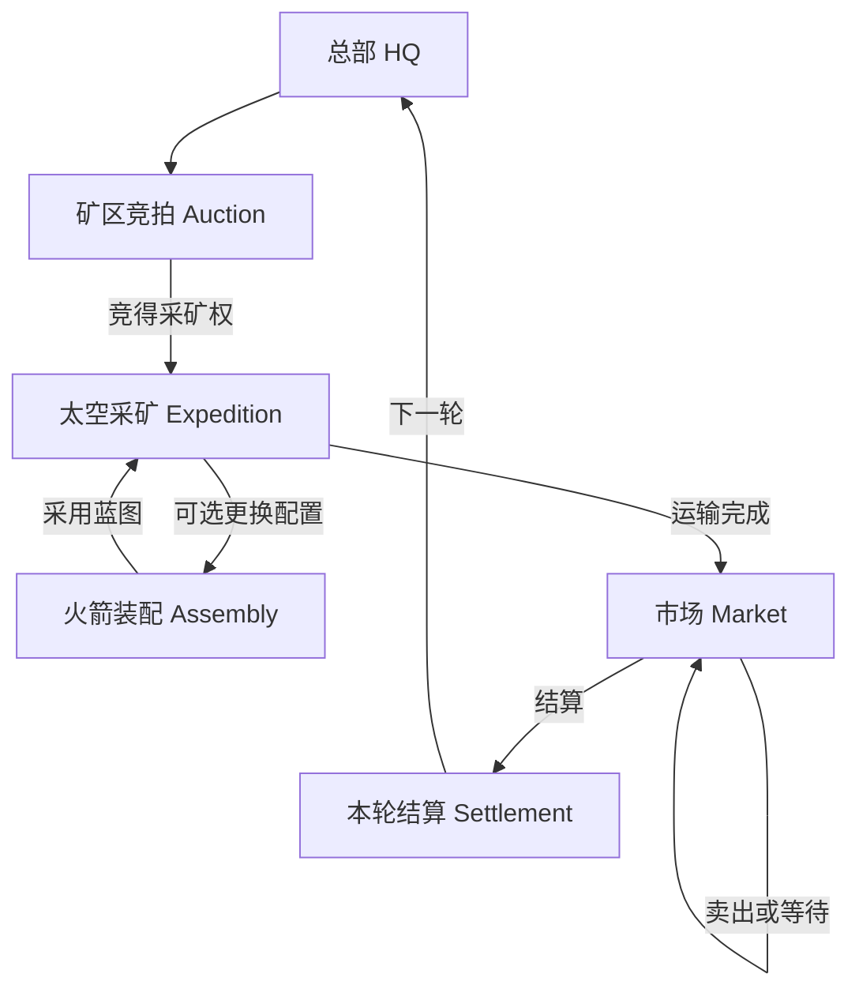
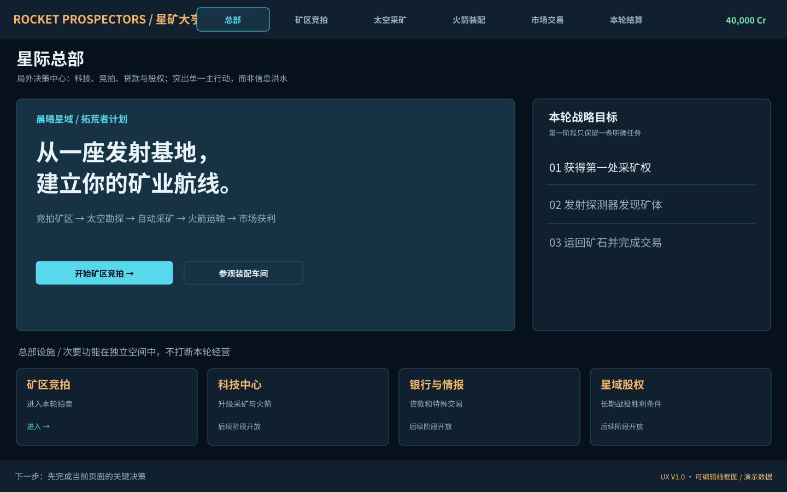
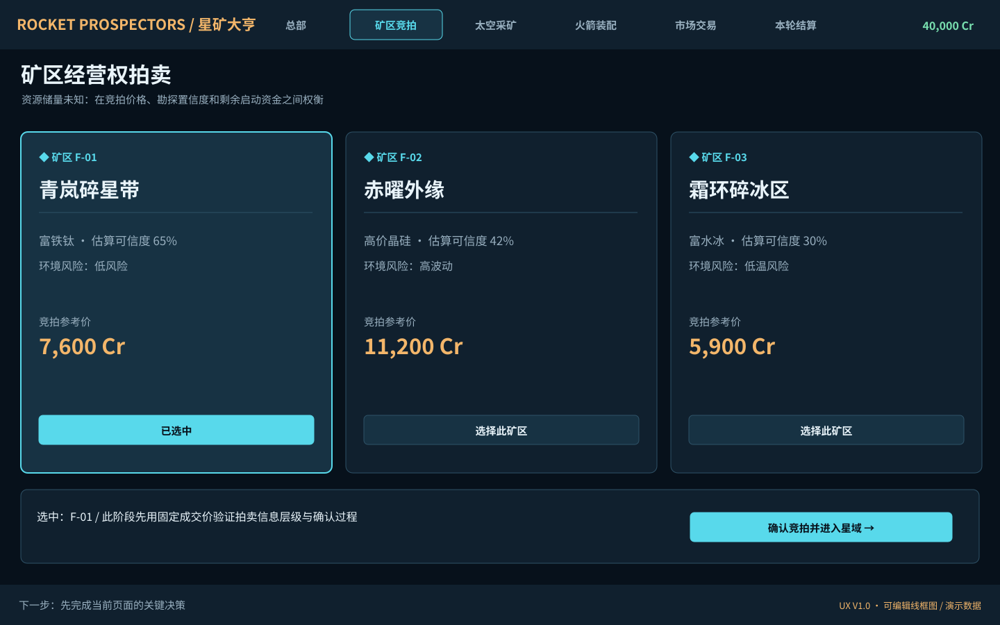
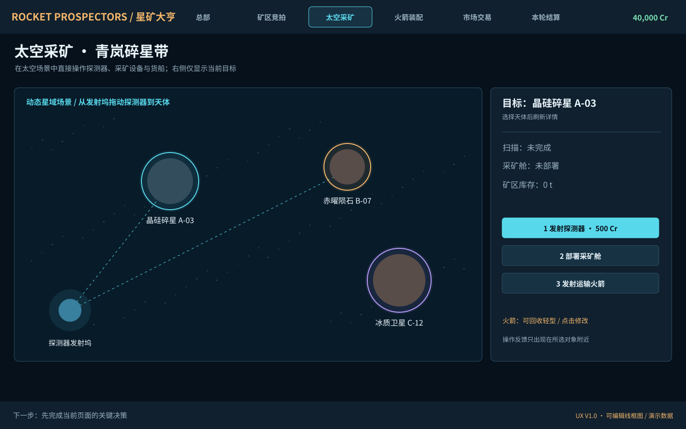
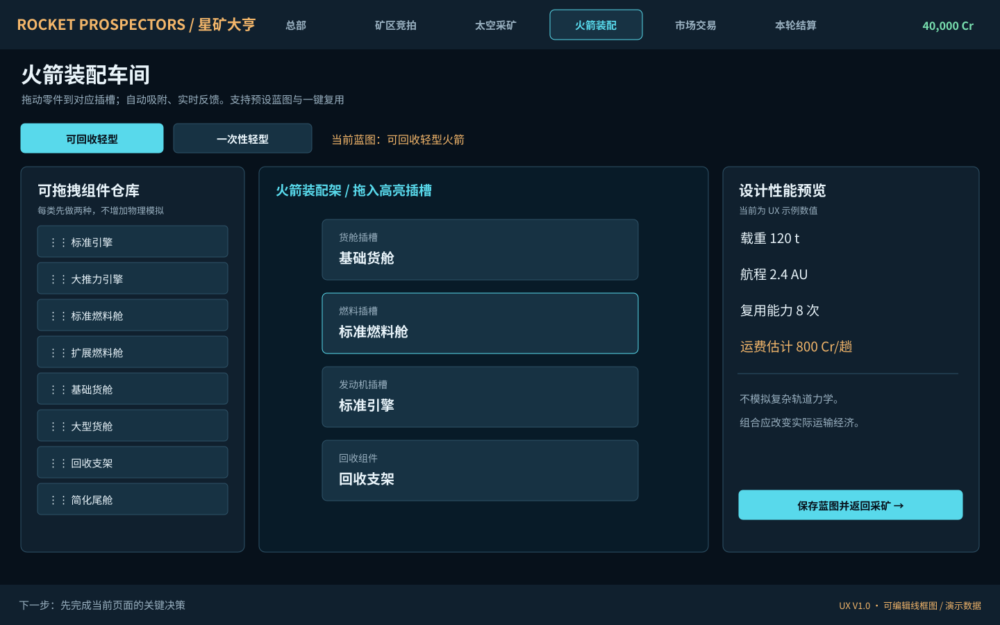
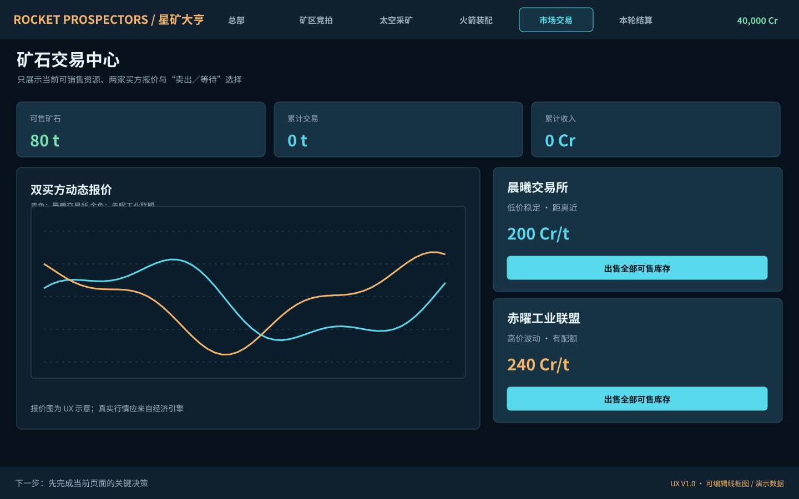
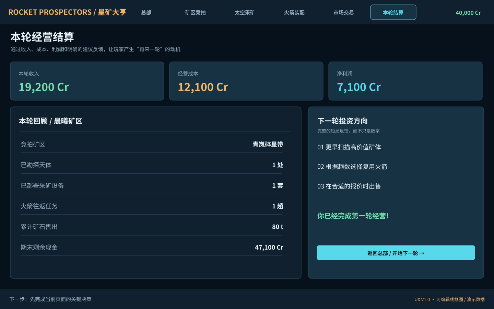

# 《星矿大亨》核心交互与六大界面设计 UX V1.0

> **状态**：预制作（M0）交互规格 + 灰盒可运行演示。日期 2026-11-08。  
> **权威产品依据**：`../gdd/Rocket_Prospectors_GDD_V1.0.md`。  
> **设计画稿**：`../../assets/ux/wireframes/01_总部.svg` 至 `06_本轮结算.svg`（SVG 可编辑；`previews/` 有 PNG）。  
> **实际实现**：`../../scenes/main.tscn`、`../../scripts/features/*/presentation`。  
> **边界**：完成六屏 UX 原型；**尚未完成真实竞价 AI、矿石生产模拟、市场动态定价、持久存档、可发布版本**。界面呈现的固定价格/余额只是演示数据。

## 0. 产品体验目标

游戏类型：**短局策略经营 + 长期战役成长**。流程是“总部 → 矿区拍卖 → 太空勘探/采矿 → 火箭运输 → 市场出售 → 结算 → 总部”。

三项需要通过用户观察验证的体验主张：
1. **第一眼能看懂**：新手进入任一界面后 5 秒内能知道主要行动，不用遍历功能菜单。
2. **用鼠标操作世界**：天体选择、拖动探测器、火箭部件拖放，都在场景直接操作；不是点击 ERP 式按钮。
3. **操作产生可见后果**：成功先修改权威状态，再播放动画；未来矿机工作、矿石装船与运输都必须连续可见。

### 游戏信息层级与屏幕预算
- 顶部：品牌、6 个主要空间导航（UX 测试期可任意跳转；正式战役按解锁显示）、现金。建议高度 **70 px**。
- 内容主体：标题 60 px + 可操作世界。采矿页面的世界画布至少占内容宽度 **约 65–70%**；非必需面板不能覆盖画布。
- 底部：只保留一行下一步提示和最近反馈。建议 **48–58 px**。
- 同一时刻只强化 **一个主要 CTA**，其它操作为次级状态；不使用 20 个常驻按钮。
- 初版设计基准 1440×900，适配目标 1280×720 / 1920×1080。小屏不得发生关键按钮被遮挡；优先折叠次要信息。

## 1. 六屏导航关系（Player Journey）

**首轮建议操作顺序**：竞拍一个地块 → 在星域选中目标 → 拖动探测器至天体 → 查看扫描结果 → 部署采矿舱 → 配置/选择一次性或可回收火箭 → 发送运输 → 查看两家报价 → 卖出 → 查看利润 → 回到总部。

初期应以“可理解的第一轮”为目标，而不是要求玩家同时掌握全部拍卖、AI、科研、金融、股份机制。

## 2. 全局交互契约

| 事项 | 统一设计规则 | UX 原型状态 |
|---|---|---|
| 选择 | 单击高亮；详情区同步显示；再次点击仍保持当前选择 | 已示范（竞拍、星域） |
| 拖放 | 物品可拖区域可识别；目标插槽高亮；非法放置不影响数据 | 星域探测器、火箭部件原型 |
| 预览 | 费用/影响/风险应在确认前展示；首次危险操作二次确认 | 模拟操作只在条件满足时可用；正式确认预览待 M1 |
| 反馈 | 成功绿色、警告琥珀、错误红色；文字不能只靠颜色 | 底部反馈已示范 |
| 扣费 | 只有经济/命令服务权威扣费，视觉事件永远不能直接扣费 | Mock 会话作演示；真实引擎未接入 |
| 撤销 | 未执行命令可取消预览；不可撤销动作须明确提示 | 待正式命令接口 |
| 跳过动画 | 必须只影响演出，不重复经济扣费或运输 | 待 M1 |
| 低动效 | 仍显示结果和进度，只降低粒子与转场 | 待视觉阶段 |
| 键盘 | Esc 关闭浮层、Tab 聚焦、Enter 确认、空格暂停（非输入状态） | 规划，不计已实现 |

## 3. 页面 U01：星际总部 HQ

**用户问题**：现在经营进行到哪一步？下一轮最优先处理什么？

**视觉结构**：
- A 顶部：当前资产、战役星域、小型导航。
- B 左侧主体：一个明确的大 CTA“开始矿区竞拍”；背景用发射基地的设备场景代替抽象数字墙。
- C 右侧：三步目标/进度，不显示所有财务指标。
- D 底部：四个总部设施卡。未解锁的科技/银行/股份以禁用态显示。

**操作表**：
| 触发 | 即时反馈 | 后续结果 | 错误态 |
|---|---|---|---|
| 单击“开始矿区竞拍” | CTA 按下，高亮导航变化 | 进入 U02 | 战役终结时禁用 |
| 单击“参观装配车间” | 工作台加载 | 进入 U04，返回可恢复场景 | 暂无 |
| 单击“科技中心” | 解锁信息提示 | 已完成研究列表或待解锁说明 | 资金不足/科技前置不足 |
| 单击“银行” | 只打开交易面板，不自动借款 | 允许查看利息与期限 | 无额度时显示原因 |
| 单击“股权” | 显示持股比例、待拍股份 | 单独股权竞拍流程 | 非拍卖阶段只读 |

**当前实现**：总部 CTA 与装配车间入口可操作，其他总部设施为明确的“规划中”展示。不得把它们描述成已实现功能。

## 4. 页面 U02：矿区经营权拍卖 Auction

**用户问题**：这块矿区值不值得投资？我的剩余启动资金是否足够？

**信息设计**：每块地卡仅显示名称、编号、预计资源、情报置信度、环境风险、参考价；真实剩余储量绝不在未勘探前泄露。显示竞价后的剩余资金以防玩家竞拍完无法开工。

**交互顺序**：
1. 看三个矿区卡 → 单击选中一处（只改变选择，不扣费）。
2. 查看“当前报价、剩余资金、AI 竞拍参与者”。
3. 点击确认出价；正式版提示成交规则及不可撤销部分。
4. 玩家竞得矿区后，播放“许可获得”反馈并进入 U03；输掉后退还冻结资金并允许继续竞拍。

**状态**：`待开始 → 竞价中 → 领先/被超价 → 成交/落败 → 离场`。未成交不应扣除最终地价；多次点击不得重复收费。

**当前实现**：固定报价的三卡选择与模拟成交，**不包含对手出价、保证金和真实拍卖时间规则**。是验证信息密度与转场的 UX Mock。

## 5. 页面 U03：太空采矿 Expedition（最重要）

**用户问题**：要开发哪个天体？我的设备在做什么？瓶颈在哪里？

**空间分区**：
- 左侧大画布占约 70%；保持基地、发射坞、天体和运行中的航线同屏可见。
- 右侧上下文卡占约 30%；没有选中天体时显示“请选择目标”，选中后显示操作与成本。
- 主场景以**向外太空部署**为核心方向；不强迫玩家在进入每颗星球时重新玩地下钻管游戏。
- 不将旧版地下剖面作为首屏默认操作；如未来增加地下挖掘玩法，需要独立设计与验证。

**关键鼠标交互**：
1. 单击天体（实际节点热区）→ 高亮边框、同步右侧属性。
2. **从基地探测器发射坞按住并拖动到天体** → 画出预览轨迹，释放后发起 `scan` 命令；没有经营权则被拒绝并解释。
3. 扫描成功 → 显示已知矿种/储量区间，扫描环逐渐消退；再次扫不重复扣费。
4. 在已扫描天体上点击“部署采矿舱”或拖动设备 → 显示落点与成本预览，确认后开工。
5. 矿机实际持续工作（未来版本），资源从矿点进入舱；仓容到上限时停产并警报。
6. 选择运输火箭或进入 U04 → 指派运输航线，点击/拖动建立目的地。
7. 发射后火箭有行程状态，返回港口后货物进入可售库存 → U05。

**正式交互状态机**：`Unknown → Targeted → Surveying → Surveyed → DeploymentPreview → MiningActive → StockWaiting → Loading → InTransit → Delivered`；失败与异常按该状态机旁路处理。

**当前实现**：点击天体、拖动探测器触发模拟扫描、部署、一次演示运输以及状态/数字更新；**没有真实时间推进、连续采矿模拟、运输轨道和产能守恒引擎**。具体模拟价格见 `ux_session.gd`。

## 6. 页面 U04：火箭装配车间 Assembly

**用户问题**：怎样组装一艘更适合本轮航线的火箭？

**三区设计**：
- 左：零件仓。仅 4 类基础组件，每类 2 种；可折叠筛选。
- 中：大型火箭装配架（主视觉），四个吸附插槽从上到下货舱/燃料/发动机/回收装置。
- 右：即时性能/经济指标，突出载重、航程、单趟运营成本与回本轮次。

**交互顺序**：
1. 选“可回收轻型”或“一次性轻型”蓝图。
2. 鼠标从左侧 `PartTile` 拖至对应的 `DropSlot`（同类合法、其他类拒绝）；或点击零件，再点击插槽作为等效输入。
3. 吸附后设备外形与右侧预计参数更新；显示低于最低航程、载荷超限等具体错误。
4. 点击“保存为蓝图”，使用时无需每趟重复组装；返回 U03 后选择同一蓝图并发射。

**关键策略**：一次性火箭采购便宜、边际发射贵；可回收火箭采购昂贵、边际发射便宜，但有维修、周转与复用损耗。**禁止**将装配变成真实轨道物理和手动驾驶小游戏。

**当前实现**：Godot 原生 `get_drag_data/drop_data` 拖放，合法槽位校验，组件名替换；可选一次性/可回收方案；右侧是定性评估示意。**未实现实际火箭网格模型、质量推力算法或蓝图库存持久化**。

## 7. 页面 U05：市场交易 Market

**用户问题**：现在卖，还是等更高价？

**视觉分布**：左侧价格趋势（展示最新报价及趋势而非海量财经指标），右侧两家买方卡，各有买入价、日配额与卖出 CTA；顶部只看总库存、累计售出和营收。

**操作顺序**：
1. 选择卖出对象，比较价格与配额。
2. 查看交易预览：售出吨数、单价、费用、实际到手收入。
3. 点击“立即出售”完成成交；未成交前可退出不卖。
4. 如果保留库存，则继续查看场景和行情，不强制卖出。
5. 玩家自行选择进入 U06 结算，正式版只在期限终止后完成期末资产处理。

**UX 守则**：不要因卖出弹出整个交易后台；确认时在局部预览，完成时只显示一个轻量 Toast。报价曲线颜色之外必须有买家名称。

**当前实现**：两家**固定演示报价**，一键出售模拟港口可售库存；报价曲线为静态演示函数，不接经济引擎。

## 8. 页面 U06：本轮经营结算 Settlement

**用户问题**：我赚了多少？为什么？下一轮我要改善什么？

**布局**：顶部三大指标：收入/投入/利润；左侧逐项回顾：资源获取、产出、运输、销售和现金；右侧只显示 2–3 条建议与“下一轮”CTA。未来股份竞拍在总部单独完成，不挤进结算主屏。

**操作顺序**：
1. 经营期限终止，锁定统计快照；只读取结果，不能在结算界面改旧账。
2. 利润先显示净额，再允许展开明细。
3. 可选查看本轮资产排名、完成奖励及采矿效率。
4. 点击返回总部；下一轮沿用合法永久升级与股权，不沿用已经结算的临时开采权。

**当前实现**：读取 `UXSession` 中演示的账本汇总，并支持重置示范回合。没有真实期末清算、股份结算或统计持久化。为了测试方便，导航仍允许提前进入本屏。

## 9. 原型中已包含 / 未包含

| 内容 | 交互原型 | 完整经营系统 |
|---|---:|---:|
| 六个独立可导航界面 | ✅ | — |
| 总部与竞拍入口 | ✅ | ❌ 真实拍卖待开发 |
| 点击天体、拖动探测器 | ✅ | ❌ 动态勘探规则待开发 |
| 采矿舱部署、示范资源变化 | ✅ | ❌ 实时采矿规则待开发 |
| 选择一次性/可回收火箭 | ✅ | ❌ 真实成本与复用规则待开发 |
| 部件跨插槽类别校验、拖放 | ✅ | ❌ 真实质量/航程/蓝图待开发 |
| 两买方卖出、收益更新 | ✅ | ❌ 真实市场模型待开发 |
| 结算可见、开始新一轮 | ✅ | ❌ 真正战役跨轮状态待开发 |
| 旧版长线代码和素材 | 不包含 | 已从新项目交付包中排除 |

## 10. 用户研究与验收（UX Exit Criteria）

最低试玩任务参见 `../production/UX_TEST_SCRIPT.md`。

- 5 位未经口头讲解的测试者，尝试从总部完成首轮交易；记录每人首次点击和困惑时长，而不是仅征求主观“好看不好看”。
- 至少 4/5 能在不解释的情况下找到矿区拍卖入口并竞得一个矿区。
- 至少 4/5 能发现“拖动探测器到天体”的操作（若失败，需要加强拖拽起点视觉与教程）。
- 至少 4/5 能独立完成一次火箭运输与市场卖出。
- 6 个页面中，每个页面至少一个明确主操作，不出现多个视觉权重同级的 CTA。
- 在 1280×720 和 1920×1080 验证无功能性遮挡。当前尚未在 Godot 运行端验证，需要本机测试。
- 重复提交、无经营权、资金不足、重复扫描等失败状态不得改变资金或库存，且玩家能读懂失败原因。

这些是**目标验收指标**，不是已经达到的用户测试结果。

## 11. UX V1.1 变更入口

所有体验修改先填写：问题复现、截图、影响任务、拟改交互、受影响 `ux_id`、测试方法、是否改 GDD 规则；先修清晰度，再加效果；在 GDD 未批准时不得自行改变收益公式。
